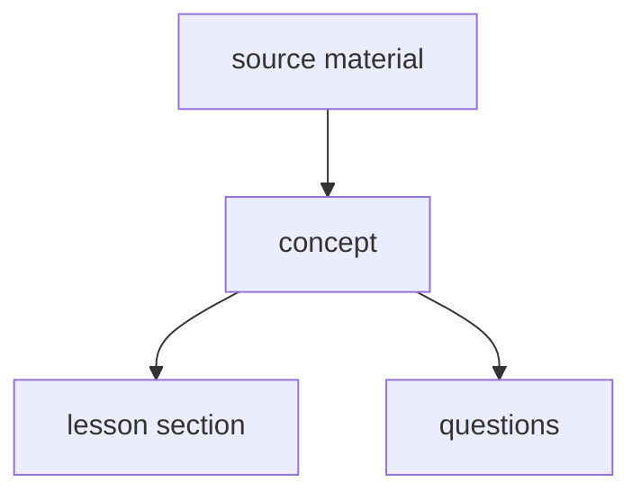

# Authoring by concept

A design for writing a module from its concepts, piloted on a second Python
module beside the first. `modules.md` gives how a module is authored today,
and this file gives what changes for a module written by concept. On any
difference, this file wins for such a module.

## Why

The review of the `python` module on 2026-11-13 counted three faults that
further review passes did not remove.

- About 120 statements were false. They sat in mechanisms, `why` entries,
  pitfalls and lesson prose, which no run checks. Keyed answers held, since
  their snippets run.
- One fact was written in up to five fields of a question and in a lesson
  sentence. A fix to one copy left the others false, and most of the 28
  defects the fix pass introduced were such copies.
- Lessons were written from their questions, so a lesson stated its
  questions' answers on their own examples. About 800 questions were
  affected.

## The order

- **A concept is written from the source material.** A concept is one claim
  about the subject, with what checks the claim and the wrong beliefs about
  it.
- **A lesson section is written from its concepts**, and teaches them on
  examples of its own.
- **A question is written from one concept**, and tests the concept's claim on
  an example the lesson does not show.
- **A layer is written from the layer above it, never from a sibling.** A
  question written from a lesson inherits the lesson's examples.

## The concept record

A subtopic's concepts live in `concepts/<topic>/<subtopic>.toml`, as its
questions live in `banks/<topic>/<subtopic>.toml`. The concept files replace
the coverage map for a module written by concept.

| Field | Holds |
|---|---|
| `id` | A slug, unique within the module and permanent, as a question id is. |
| `level` | The concept's level. Its questions sit at the same level. |
| `claim` | One or two sentences. The only place the fact is stated in full. |
| `versions` | The supported versions the claim holds on. Absent means all. |
| `source` | A URL with an anchor, to the documentation or the specification. |
| `witness` | Code whose output shows the claim holds. |
| `output` | The witness's output, the same on every supported build. |
| `quote` | The source's sentence the claim rests on, where no witness can run. |
| `misconceptions` | Wrong beliefs about the claim, one sentence each. |
| `taught_by` | The lesson section teaching the concept, as `<slug>#<anchor>`. |

- **A witness is run on every supported build by the module check.** Its
  output is compared with the output the record shows. A witness shows what
  the code does, and the reader of stage 1 checks that the claim says the
  same thing.
- **A concept that no code can show carries no witness**, and its `quote`
  holds the sentence of the source the claim rests on. Advice such as "prefer a
  `Sequence` parameter" is such a concept.
- **A misconception is the wrong belief itself**, such as "`a or b` returns a
  bool". Distractors, traps and pitfalls are drawn from the list.
- **A concept at level 2 or 3 may be an interaction**, such as "a `finally`
  return replaces an exception in flight". The interaction is its own claim,
  so a question still names one concept.

## Lessons and questions

- **A lesson section asserts only the claims of the concepts that name it.**
  A sentence stating any other fact is a defect, since no witness checks it.
- **A lesson file holds no intro.** The seed renders the intro from the
  lesson's section headings. An intro written by hand either missed a section
  or asserted a fact no concept holds.
- **A section's example shows the main point of its claim**, chosen against
  the concept's misconceptions. The witness proves every clause of the claim,
  so the example need not show each one.
- **For each misconception a section targets, the example's output differs
  from the output the misconception predicts.** An example that prints the
  same under the claim and under a misconception teaches neither. A `return`
  can hide a step the misconception is about, where a `print` shows it.
- **A section states no consequence beyond its claims**, even a true one. A
  consequence is a fact, and no witness checks it.
- **A section uses only constructs the lessons it `needs` have taught**, the
  module's baseline, or constructs the section explains itself. A module's
  `CLAUDE.md` lists its baseline.
- **A claim that some code is a `SyntaxError` is stated in the lesson and
  shown by a question.** A lesson block that showed it would need `compile`,
  which a lesson does not teach. A `debug` question shows the refused code as
  written.
- **The first section to use a piece of syntax introduces it**, such as the
  `match` and `case` statements or a class pattern like `int()`.
- **The seed renders a lesson's common mistakes and its links from its
  concepts**: the misconceptions, and the sources. A lesson file holds
  neither section, since a copy written by hand drifts from the concepts.
- **A question names its concept**, as `concept = "<id>"`. The seed derives
  the question's lesson section from the concept's `taught_by`, so a question
  carries no `lesson` field.
- **A question's level is its concept's level.**
- **A question adds no claim.** The detail a client shows is the concept's
  claim and misconceptions. A question carries what is its own alone: the
  prompt, the code, the choices or accepted replies, the answer, and a `why`
  per choice.
- **A wrong choice's `why` names the misconception it embodies.**
- **The kind called `concept` in `python` is called `principle` in a module
  written by concept.** A kind and a record would otherwise share one name.

## Stages

A subtopic is written in three stages. A stage starts once the one before it
is approved.

1. **Concepts.** The concepts are written from the sources, and the module
   check runs every witness. A reviewer checks the concepts against the
   stage 1 checklist below, and the author of the module approves the list
   after that review. A list of about thirty claims reads in minutes, and an
   error caught here reaches no lesson and no question.
2. **Lessons.** The sections are written from the approved concepts. A
   reviewer checks each section against its concepts: every claim taught,
   and no sentence beyond them. Stage 2 ends as stage 1 does: an independent
   review finds no false statement, and the other findings are fixed in
   place. In the pilot, five reviews and three fresh generations of the same
   lessons settled at 13 to 15 findings each, mostly local.
3. **Questions.** The questions are written from the approved concepts. A
   reviewer checks each against its concept and the section teaching it.

- **A defect found in a later stage is fixed in the layer it belongs to.** A
  wrong claim found while writing a question goes back to stage 1, and the
  lesson and the questions built on it are checked again.
- **A review in a stage checks one layer against the layer above.** It reads
  against a list of checks, and it ends when every item of the list is
  checked.

## The stage 1 checklist

A concept passes stage 1 when each item holds. Every lesson defect traced
back to a concept in the pilot broke one of them.

- **The claim states the result**, not only the behaviour. A claim about
  `x if c else y` says the expression evaluates to `x` when `c` is true.
- **Every misconception has a clause of the claim that refutes it.** A
  misconception no clause answers leaves the lesson to answer it with a fact
  no witness checks.
- **Every term the claim uses is defined in the claim, in a concept the
  subtopic orders earlier, or in the module's baseline.** "Iterable",
  "iterator" and "generator" were each used before any claim defined them.
- **The claim's wording holds beyond its witness.** A witness proves what it
  prints. The reviewer tries one more case the wording covers, and runs it.
  A claim that "a capture pattern is allowed only in the last case" passed its
  witness and was false for `case [a, b]:`.
- **The claim follows the module's writing rules**, since a lesson copies
  its wording.
- **Stage 1 ends when an independent review finds no wrong claim.** A review
  sorts each finding as wrong, gap or style. The author of the module decides
  a disputed scope. The author fixes the gaps a lesson will clearly need and
  leaves the rest, since a gap that matters returns in stage 2 as a lesson
  finding. Style is applied without a further review. In the pilot, four
  rounds of review brought wrong claims to one a round, while each fresh
  reviewer found about ten new gaps, so a rule waiting for no gaps never ends.
- **A claim is precise through its scope, not exhaustive.** A case the
  wording gets wrong inside its scope is fixed in the wording. A case that
  belongs to a higher level, or is trivia, is put outside the claim by
  narrowing its scope, and becomes a concept of its own or nothing. A claim of
  level 0 that lists every edge stops being readable at level 0.

## Mechanical checks

The module check adds these for a module written by concept.

- Every witness runs on every supported build and prints its shown output.
- Every concept without a witness quotes its source.
- Every `taught_by` resolves to a section, and every section is named by at
  least one concept.
- Every question names a known concept, and every concept has at least one
  question.
- A question and the section teaching its concept share no example, as rule
  15 gives.

## The parallel module

- **The new module's slug is `py`, and its title is "Python (new)" until it
  replaces `python`.** The log names a module by its slug, so a slug is
  permanent, and a title can change at any time.
- **`python` stays seeded beside `py`.** A user pauses either module, as
  `knowledge.md` `## Module status` gives.
- **`python` receives fixes to false statements alone** while `py` is
  written. Any other change there would be rewritten by `py`.
- **A question of `python` may supply an idea to `py`**, a misconception or
  an example, but never its text. Its text was written by the order this
  file replaces.

## Pilot

- **The pilot writes `py`'s `core/control-flow` subtopic, levels 0 and 1,**
  through all three stages.
- **The pilot exits on an independent review of its result**, counting
  defects per hundred questions against the same subtopic of `python` in the
  review of 2026-11-13.

## Deferred

- **How a wrong choice names its misconception**, as an index, an id or a
  quoted sentence. The first questions written show which one reads well.
- **Which mechanical checks `check.py` implements.** During the pilot, a
  check `check.py` lacks runs as a script written for the pilot. The pilot's
  work shows which checks repay a place in `check.py`.
- **Whether the engine generates a lesson or a question from a concept.** The
  pilot writes each lesson and question in its own authoring step first.
- **When `py` replaces `python`**, and what happens to a user's answers in
  `python` then.

The seed is the exception, and it changes before the pilot is seeded. It
reads the concept files, and derives each question's lesson section, level
and detail from the question's concept. It also renders each lesson's intro
from its headings, and its common mistakes and links from its concepts.
Without that change, a question or a lesson would copy those fields from its
concepts, which is the duplication this design removes.
