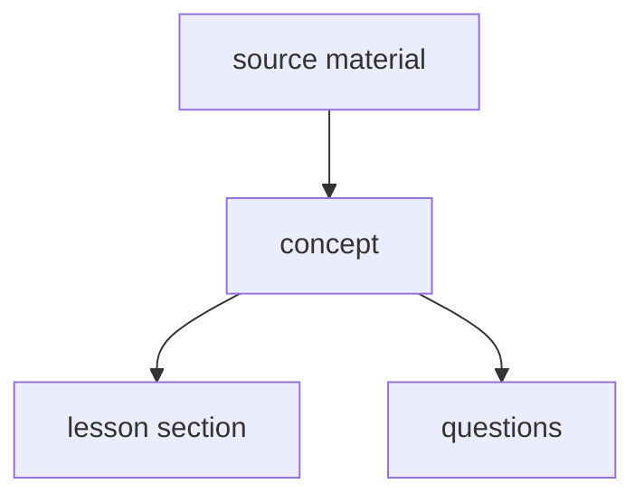

# Authoring by concept

A design for writing a module from its concepts, piloted on a second Python
module beside the first. `modules.md` gives how a module is authored today,
and this file gives what changes for a module written by concept. On any
difference, this file wins for such a module.

## Why

The review of the `python` module on 2026-11-13 counted three faults that
further review passes did not remove.

- About 120 statements were false. They sat in mechanisms, `why` entries,
  pitfalls and lesson prose, which no run checks. Keyed answers held, since
  their snippets run.
- One fact was written in up to five fields of a question and in a lesson
  sentence. A fix to one copy left the others false, and most of the 28
  defects the fix pass introduced were such copies.
- Lessons were written from their questions, so a lesson stated its
  questions' answers on their own examples. About 800 questions were
  affected.

## The order

- **A concept is written from the source material.** A concept is one claim
  about the subject, with what checks the claim and the wrong beliefs about
  it.
- **A lesson section is written from its concepts**, and teaches them on
  examples of its own.
- **A question is written from one concept**, and tests the concept's claim on
  an example the lesson does not show.
- **A layer is written from the layer above it, never from a sibling.** A
  question written from a lesson inherits the lesson's examples.

## The concept record

A subtopic's concepts live in `concepts/<topic>/<subtopic>.toml`, as its
questions live in `banks/<topic>/<subtopic>.toml`. The concept files replace
the coverage map for a module written by concept.

| Field | Holds |
|---|---|
| `id` | A slug, unique within the module and permanent, as a question id is. |
| `level` | The concept's level. Its questions sit at the same level. |
| `claim` | One or two sentences. The only place the fact is stated in full. |
| `versions` | The supported versions the claim holds on. Absent means all. |
| `source` | A URL with an anchor, to the documentation or the specification, or a list of them where one section does not cover every clause. |
| `witness` | Code whose output shows the claim holds. |
| `output` | The witness's output, the same on every supported build. |
| `quote` | The source's sentence the claim rests on, where no witness can run. |
| `misconceptions` | Wrong beliefs about the claim, each `{ id, text }`. |
| `taught_by` | The lesson section teaching the concept, as `<slug>#<anchor>`. |

- **A witness is run on every supported build by the module check.** Its
  output is compared with the output the record shows. A witness shows what
  the code does, and the reader of stage 1 checks that the claim says the
  same thing.
- **A concept that no code can show carries no witness**, and its `quote`
  holds the sentence of the source the claim rests on. Advice such as "prefer a
  `Sequence` parameter" is such a concept.
- **A misconception is the wrong belief itself**, such as "`a or b` returns a
  bool". Distractors, traps and pitfalls are drawn from the list.
- **A concept at level 2 or 3 may be an interaction**, such as "a `finally`
  return replaces an exception in flight". The interaction is its own claim,
  so a question still names one concept.

## Levels

A concept's level says how far into Python a learner is before the concept
matters to them. `docs/architecture/knowledge.md` names the four levels. This
section gives the test the stage 1 writer applies and the reviewer checks.

| Level | Name | The learner it serves | A concept at it |
|---|---|---|---|
| 0 | Foundation | one writing a first program | one construct and the result it gives |
| 1 | Associate | one writing Python every working day | an exception to a rule, a pitfall, or a choice between two tools |
| 2 | Professional | one writing code that others build on | two mechanisms interacting, or a protocol a class implements |
| 3 | Expert | one maintaining a runtime, a library or a large codebase | an implementation detail, a difference between versions, or a rare failure |

- **A concept sits at the lowest level whose learner meets it in ordinary
  code.** A first program meets `round(2.5)`, and a week of work meets a
  closure binding its loop variable late. A fact deferred past that level
  arrives after the learner needed it.
- **A concept's level is at least the level of every fact its claim needs**,
  in its own subtopic or a needed one. Its witness and its questions then use
  only what a learner at that level holds.
- **A level 0 claim states one construct's result.** It may carry the
  exception most first programs meet. A case only some programs meet is left
  out of the claim and written at a higher level, or not at all.
- **A level 2 concept often combines two facts a learner holds at level 1.**
  `__eq__` defined without `__hash__` combines equality with hashing, and
  neither fact predicts the combination alone.
- **A level 3 concept may need a `versions` field or a quote.** Behaviour that
  differs between builds, or that no witness shows on every build, sits here.
  A witness is still preferred, since a quote gives the review nothing to run.
- **The levels are relative to the module, not to the language.** A level 1
  concept of `core` and one of `concurrency` both serve a learner who writes
  Python every working day, and the second learner simply works with
  threads.
- **The subtopics written before this section are not examples to copy.**
  Their levels were set without a rubric, so a review may move a concept they
  hold. `round-half-even` and `try-except-catches` stand at level 0, and
  `default-evaluated-once` and `late-binding` at level 1, as this test gives.

### Re-levelling

A module's written concepts are re-levelled against `## Levels` in three
steps, with no step waiting for the author.

1. **Assess.** One session reads every written concept's claim and level,
   across the module, and proposes moves. Each move names the rule of
   `## Levels` it rests on. One session reads the whole module, since drift
   between subtopics shows only when they are read side by side.
2. **Verify.** A fresh session, which proposed nothing, judges each move
   against `## Levels`. A move it disputes is dropped, and the concept keeps
   its level. A wrong rejection leaves a concept where it was, which costs
   less than a wrong move.
3. **Apply.** Each subtopic with agreed moves is changed on a branch of its
   own: the concept's `level`, its lesson section, and the examples and
   questions the move breaks. Diff reviews check the change under the
   stopping rule, and the subtopic's digest gains `## Re-levelled`.

- **A moved question keeps its id**, as rule 20 of `rules.md` gives, so its
  answers still count. It leaves one group and joins another, and coverage
  shifts between the two.
- **A question changes only where a move forces it.** A re-level is not a
  further review of the subtopic.
- **A move that would retire a question on the content repository's `main`
  goes to the digest's `## For you`**, and is not applied. The answers users
  gave to that question would stop counting.

## Lessons and questions

- **A lesson section asserts only the claims of the concepts that name it.**
  A sentence stating any other fact is a defect, since no witness checks it.
- **A lesson file holds no intro.** The seed renders the intro from the
  lesson's section headings. An intro written by hand either missed a section
  or asserted a fact no concept holds.
- **A section's example shows the main point of its claim**, chosen against
  the concept's misconceptions. The witness proves every clause of the claim,
  so the example need not show each one.
- **A section targets the misconceptions its example can separate.** The
  others reach the learner through the lesson's common mistakes, which the
  seed renders.
- **For each misconception a section targets, the example's output differs
  from the output the misconception predicts.** An example that prints the
  same under the claim and under a misconception teaches neither. A `return`
  can hide a step the misconception is about, where a `print` shows it.
- **A section states no consequence beyond its claims**, even a true one. A
  consequence is a fact, and no witness checks it.
- **A section uses only constructs the lessons it `needs` have taught**, the
  module's baseline, or constructs the section explains itself. A module's
  `CLAUDE.md` lists its baseline. `needs` is transitive: the lessons of a
  subtopic the subtopic needs count, and so do the earlier sections of the
  same lesson. A construct no concept teaches is added to the baseline
  rather than explained in a section, since the explanation would be a fact
  no witness checks.
- **A claim that some code is a `SyntaxError` is stated in the lesson and
  shown by a question.** A lesson block that showed it would need `compile`,
  which a lesson does not teach. A `debug` question shows the refused code as
  written.
- **The first section to use a piece of syntax introduces it**, such as the
  `match` and `case` statements or a class pattern like `int()`.
- **The seed renders a lesson's common mistakes and its links from its
  concepts**: the misconceptions, and the sources. A lesson file holds
  neither section, since a copy written by hand drifts from the concepts.
- **A question names its concept**, as `concept = "<id>"`. The seed derives
  the question's lesson section from the concept's `taught_by`, so a question
  carries no `lesson` field.
- **A question's level is its concept's level.**
- **A question adds no claim.** The detail a client shows is the concept's
  claim and misconceptions. A question carries what is its own alone: the
  prompt, the code, the choices or accepted replies, the answer, a `why` per
  choice, and an `explain` applying the claim to the question's own example.
- **A question applies its claim inside a task its section does not show.**
  The question shares no name, value, output or helper function with the
  section, and does not restate an expression of the claim with new values,
  since the section copies the claim's wording. The witness is never served,
  so a question may share its shape.
  A claim about one expression is asked inside a larger snippet, so the
  learner has to see where the rule applies. A claim of level 0 is often one
  expression, and the pilot's first questions repeated 17 of the lessons'
  examples with only their names or values changed. A fresh generation
  briefed with this rule still repeated 19 of 60. A review naming a new task
  for each repeated question is the step that removes them, so stage 3's
  review checks this rule question by question.
- **The question changes, not the section**, where rule 15 of `rules.md` finds
  a shared example. The section was approved in stage 2, before any question
  existed.
- **A question uses the constructs its subtopic teaches at its level or
  below**, the subtopics it needs, and the module's baseline. A queue serves
  questions by subtopic and level, never by lesson, so a question of the
  conditions lesson may use a `for` loop taught at the same level. The facts
  its keyed answer rests on sit at its level or below too, and the phone pass
  over `core/functions` found a level 0 question keyed on a level 1 fact.
- **A wrong choice names the misconception it embodies, by its id**, as
  `misconception = { B = "<id>" }`, or as `"<concept>#<id>"` for a
  misconception of another concept. A good distractor can embody another
  concept's belief, and naming it lets rule 19 count that belief as tested.
  An id stays when the misconception's text is reworded. A removed or
  renamed misconception makes the check refuse every question still naming
  it, where an index would shift silently onto another belief. The lesson's
  common mistakes follow the concept at the next seed, since the seed
  renders them.
- **A question asks its own concept's claim, and may use another concept's
  fact as a step.** Rule 14 counts the fact a question asks, not every fact
  its code relies on.
- **The kind called `concept` in `python` is called `principle` in a module
  written by concept.** A kind and a record would otherwise share one name.

## Stages

A subtopic is written in three stages. A stage starts once the one before it
meets the stopping rule.

The author of the module approves by exception. A session applies each
fix a review recommends and records the decision. A decide session answers
the questions the stages leave, and only two kinds reach the author. In the
pilot the author approved the recommended fix nearly every time, so a
question per fix cost the author's time and changed little.

- **A session decides alone, and records each decision in the subtopic's
  digest:** a fix that follows the written rules, a misconception added
  where a clause of the claim already refutes it, a rewritten choice or
  snippet, a pair kept as one fact asked twice, and a scope where the
  reviewer and the writer agree.
- **A session also rewords or narrows a claim a review found false,** when
  the review's fix makes the claim true. The next review of the fix's diff
  checks the new wording. Waiting for the author left a false claim in the
  files: one subtopic held two after its first stage.
- **A session leaves a question, and goes on without the change:** a
  claim reworded for any reason other than being false, a scope the
  reviewer and the writer dispute, a claim fix a diff review still
  disputes, and a change to `rules.md`, this file, a skill or the engine.
- **A decide session answers the questions once the three stages end.** It
  is a fresh session that wrote none of the subtopic's files. For each
  question it applies the change, keeps the files as they are, or defers
  the case to a later level. It reads the recommendation beside a question
  as advice. A recommendation from the session that raised it once named
  one construct outside the baseline, in an example that held four.
- **A diff review checks the decide session's edits**, under the stopping
  rule of every stage. A decision changes a claim or a question as a fix
  does, and rule 23 holds for a fix.
- **Two kinds of question still go to the author.** The first is a change
  outside the subtopic's own files: `rules.md`, this file, a skill, the
  engine, or the module's `CLAUDE.md` and its baseline. Such a change
  reaches every later subtopic. The second is a change retiring a question
  that is already on the content repository's `main`, since the answers
  users gave to it stop counting.
- **The digest** is `review/<topic>--L<level>.md` in the module's
  directory. It opens with `## For you`: the questions left for the author,
  at most three, or `Nothing.`. `## Decided` follows, with one line per
  question the decide session answered: the decision and its reason. The
  rest of the digest is a log the author need not read: what was written,
  each decision taken alone, and each scope deferred to a later level.
- **A question about the rules, a skill or the engine** goes to one list
  for the whole run, beside its report, since one such question recurs
  across subtopics. The list holds each question once.

1. **Concepts.** The concepts are written from the sources, and the module
   check runs every witness. A reviewer checks the concepts against the
   stage 1 checklist below. An error caught here reaches no lesson and no
   question.
   - Stage 1 also lays out the subtopic's lessons, since each `taught_by`
     names a lesson and a section. Each lesson's `needs` and the order of
     its headings follow the concept order, so every construct a witness
     uses is taught before the section teaching that witness's concept. It
     adds the subtopic to `course.toml` and to `graph.toml`, with the
     subtopics it needs, and writes each lesson file as its `##` headings
     alone. The check then holds every `taught_by`
     to a section, and stage 2 writes under the approved headings.
   - The approval is recorded in the concept file's header, with its date
     and the scopes the author decided.
2. **Lessons.** The sections are written from the approved concepts. A
   reviewer checks each section against its concepts: every claim taught,
   and no sentence beyond them. Stage 2 ends as stage 1 does: an independent
   review finds no false statement, and the other findings are fixed in
   place. In the pilot, five reviews and three fresh generations of the same
   lessons settled at 13 to 15 findings each, mostly local.
3. **Questions.** The questions are written from the approved concepts. A
   reviewer checks each against its concept and the section teaching it,
   and names a new task for each question repeating its section. The
   findings are fixed in place, and the stage ends on the stopping rule of
   stage 1. A finding about a concept reopens stage 1, and is decided as
   the digest rules above give.

In every stage, the stopping rule waives a full review of the fixed layer,
not rule 23: a second reader reviews the last fix pass on its diff. In stage
3, the first fix pass rewrote 19 questions with no false statement and
seven new defects, which only a review of its diff found.

- **After the first full review that finds nothing wrong, each round is a
  review of the last fix pass's diff.** A stage runs at most two full
  reviews: after the second, each round reviews the diff even when the full
  review found a wrong claim. The stage ends when a diff review finds
  nothing wrong, and its defects and style findings are applied without a
  further review. The module check still runs over that last fix pass. In
  the first subtopic written in the background, the diff reviews after the
  last wrong claim found one or two small defects each, at the cost of a
  full round of review and fix every time. A fresh full review after each
  fix pass found one wrong claim each time in prose the fix pass had just
  written, and a review of the diff finds that prose too.
- **A finding about an approved layer does not pause the stage.** The stage
  goes on without the change, and the author decides the finding at its
  end.

Each stage is written by one agent and reviewed by another, which wrote
nothing it reviews. The `concept-author` skill in `.claude/skills/` holds the
brief each agent is given.

- **A defect found in a later stage is fixed in the layer it belongs to.** A
  wrong claim found while writing a question goes back to stage 1, and the
  lesson and the questions built on it are checked again.
- **A review in a stage checks one layer against the layer above.** It reads
  against a list of checks, and it ends when every item of the list is
  checked.

## The stage 1 checklist

A concept passes stage 1 when each item holds. Every lesson defect traced
back to a concept in the pilot broke one of them.

- **The claim states the result**, not only the behaviour. A claim about
  `x if c else y` says the expression evaluates to `x` when `c` is true.
- **Every misconception has a clause of the claim that refutes it.** A
  misconception no clause answers leaves the lesson to answer it with a fact
  no witness checks.
- **Every term the claim uses is defined in the claim, in a concept the
  subtopic orders earlier, or in the module's baseline.** "Iterable",
  "iterator" and "generator" were each used before any claim defined them.
  The subtopic orders its concepts as its file lists them. A concept of a
  subtopic this one `needs` counts as earlier.
- **An example can separate every misconception.** For each one, the
  reviewer names an output the claim gives and the misconception does not,
  from code using the baseline and the concepts ordered before it. In
  `core/functions`, two misconceptions needed a level 1 fact or `id()` to be
  told apart, and no lesson at their level could target them.
- **Every misconception's text is false wherever the claim's scope reaches.**
  A misconception that is true in one case teaches that case wrong. In
  `core/functions`, four wrong claims were misconceptions that a `:=`, a
  `+=` or arithmetic on None made true.
- **A witness uses only the baseline and the concepts ordered before its
  own.** It catches an exception it shows and prints the exception's type,
  since the message of an uncaught one differs between builds. A witness
  shows a `SyntaxError` through `compile()`.
- **The claim's wording holds beyond its witness.** A witness proves what it
  prints. The reviewer tries one more case the wording covers, and runs it.
  A claim that "a capture pattern is allowed only in the last case" passed its
  witness and was false for `case [a, b]:`.
- **The claim follows the module's writing rules**, since a lesson copies
  its wording.
- **The concept's level follows `## Levels`.** A review reports a level the
  test does not give as a gap. Moved now, a concept moves one record. Moved
  after stage 3, it moves a lesson section and its questions too.
- **Stage 1 ends when an independent review finds no wrong claim.** A review
  sorts each finding as wrong, gap or style. A disputed scope goes to the
  author. The writer fixes the gaps a lesson will clearly need and leaves
  the rest, since a gap that matters returns in stage 2 as a lesson
  finding. Style is applied without a further review. In the pilot, four
  rounds of review brought wrong claims to one a round, while each fresh
  reviewer found about ten new gaps, so a rule waiting for no gaps never ends.
- **A claim is precise through its scope, not exhaustive.** A case the
  wording gets wrong inside its scope is fixed in the wording. A case that
  belongs to a higher level, or is trivia, is put outside the claim by
  narrowing its scope, and becomes a concept of its own or nothing. A claim of
  level 0 that lists every edge stops being readable at level 0.

## Mechanical checks

The module check holds a module written by concept to rules 26 to 29 of
`rules.md`: the witnesses, the concept records, the lessons' sections and
the prose a program can check. Rule 19 files each question by its concept.
It warns of a concept no question tests, and of a misconception no wrong
choice embodies. Rule 3 refuses a `short` question whose every accepted
reply is `True`, `False`, yes or no. Rule 15 compares a question with the
lesson its concept names, as it does for any module. It also warns of a
question sharing a name or a literal with its section's code, beside the
API the section teaches. That warning caught 7 of the 17 repeats the
pilot's first review found, so the review still compares each question
with its section.

## The parallel module

- **The new module's slug is `py`, and its title is "Python (new)" until it
  replaces `python`.** The log names a module by its slug, so a slug is
  permanent, and a title can change at any time.
- **`python` stays seeded beside `py`.** A user pauses either module, as
  `knowledge.md` `## Module status` gives.
- **`python` receives fixes to false statements alone** while `py` is
  written. Any other change there would be rewritten by `py`.
- **A question of `python` may supply an idea to `py`**, a misconception or
  an example, but never its text. Its text was written by the order this
  file replaces.

## Pilot

- **The pilot writes `py`'s `core/control-flow` subtopic, levels 0 and 1,**
  through all three stages.
- **The pilot closed on 2026-11-13, and the order is adopted** for every new
  module and subtopic. Each layer is written from the layer above it, so a
  defect is traced to one layer and fixed there, and each rule the pilot
  added is checked or briefed for the next subtopic. A comparison of
  defect counts against `python` was dropped: `python`'s latest review
  looked for false statements alone, so its count measures a different
  thing, and the order is kept even where a first subtopic scores worse.

## Deferred

- **Whether the engine generates a lesson or a question from a concept**, as
  a command. The pilot wrote each stage through the skill's agents. A command
  follows once the briefs stop changing between subtopics.
- **When `py` replaces `python`**, and what happens to a user's answers in
  `python` then.

The seed is the exception, and it changes before the pilot is seeded. It
reads the concept files, and derives each question's lesson section, level
and detail from the question's concept. It also renders each lesson's intro
from its headings, and its common mistakes and links from its concepts.
Without that change, a question or a lesson would copy those fields from its
concepts, which is the duplication this design removes.
